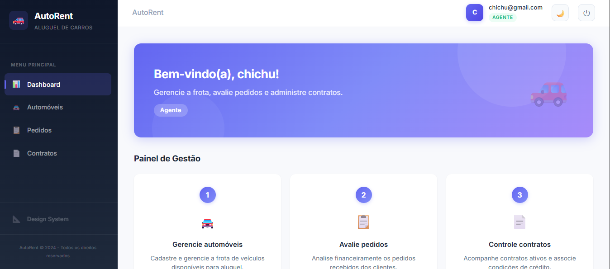
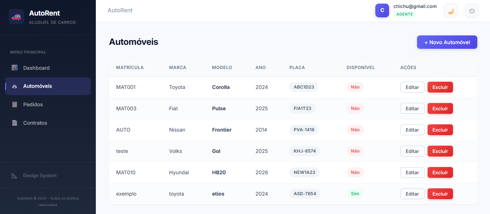
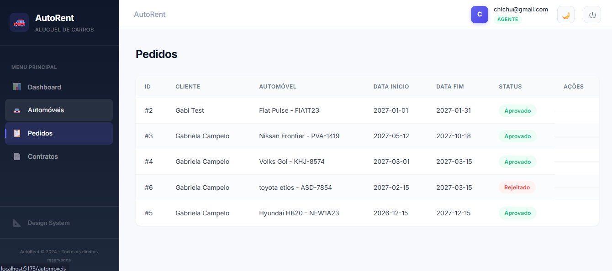
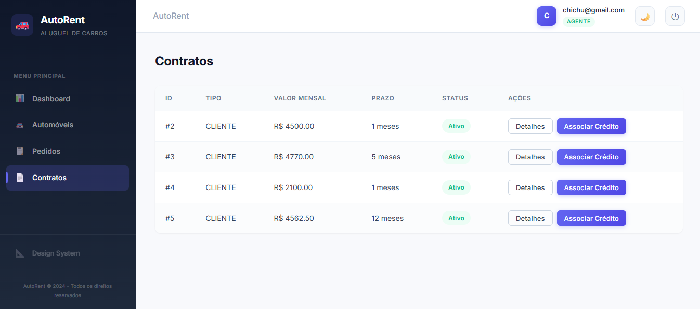
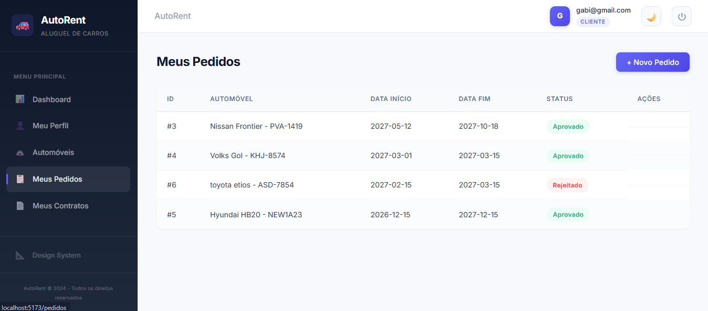

# AutoRent - Sistema de Aluguel de Carros

<table>
  <tr>
    <td width="800px">
      <div align="justify">
        Sistema web para apoio à gestão de aluguéis de automóveis, permitindo efetuar, cancelar e modificar pedidos de aluguel através da Internet. O sistema possui dois perfis de usuário: <b>Clientes</b>, que podem criar, modificar, consultar e cancelar pedidos de aluguel; e <b>Agentes</b> (empresas e bancos), que avaliam financeiramente os pedidos e, em caso de parecer positivo, aprovam a execução do contrato. Sobre os contratantes, armazenam-se dados de identificação (RG, CPF, Nome, Endereço), profissão e até 3 entidades empregadoras com seus rendimentos. Os automóveis podem ser registrados como propriedade de clientes, empresas ou bancos, dependendo do tipo de contrato. O aluguel pode estar associado a um contrato de crédito concedido por um banco agente.
      </div>
    </td>
    <td>
      <div align="center">
        
      </div>
    </td>
  </tr>
</table>

---

## Status do Projeto

     

---

## Links do Projeto

* **Aplicação Web:** [https://aluguel-carros-va53.onrender.com](https://aluguel-carros-va53.onrender.com)
* **API Backend:** [https://aluguel-carros-backend.onrender.com](https://aluguel-carros-backend.onrender.com)
* **Design System:** [https://aluguel-carros-va53.onrender.com/design](https://aluguel-carros-va53.onrender.com/design)

---

## Índice

- [Links do Projeto](#links-do-projeto)
- [Sobre o Projeto](#sobre-o-projeto)
- [Funcionalidades Principais](#funcionalidades-principais)
- [Tecnologias Utilizadas](#tecnologias-utilizadas)
- [Arquitetura](#arquitetura)
- [Modelagem UML](#modelagem-uml)
- [Instalação e Execução](#instalação-e-execução)
  - [Pré-requisitos](#pré-requisitos)
  - [Variáveis de Ambiente](#variáveis-de-ambiente)
  - [Instalação de Dependências](#instalação-de-dependências)
  - [Inicialização do Banco de Dados](#inicialização-do-banco-de-dados-supabase)
  - [Como Executar a Aplicação](#como-executar-a-aplicação)
- [Estrutura de Pastas](#estrutura-de-pastas)
- [Demonstração](#demonstração)
- [Documentações Utilizadas](#documentações-utilizadas)
- [Autores](#autores)
- [Licença](#licença)

---

## Sobre o Projeto

Este projeto foi desenvolvido como **Laboratório 02** da disciplina de **Desenvolvimento e Integração de Aplicações Web (DIAW)** do curso de **Engenharia de Software** da PUC Minas, sob orientação do **Prof. João Paulo Carneiro Aramuni**.

O objetivo é construir um sistema web completo para gestão de aluguéis de automóveis, seguindo a arquitetura MVC e integrando front-end e back-end através de uma API REST.

**Contexto do sistema:**
- O sistema só pode ser utilizado após cadastro prévio e autenticação (login com email e senha)
- Clientes podem introduzir, modificar, consultar e cancelar pedidos de aluguel
- Agentes (empresas e bancos) podem modificar e avaliar pedidos financeiramente
- Pedidos aprovados geram contratos, que podem ser associados a contratos de crédito bancário
- O sistema é subdividido em dois subsistemas: gestão de pedidos/contratos e construção dinâmica das páginas web

---

## Funcionalidades Principais

- **Autenticação Segura:** Cadastro e login com JWT (JSON Web Token), com perfis diferenciados para Cliente e Agente
- **CRUD de Clientes:** Cadastro completo com dados de identificação (RG, CPF, Nome, Endereço), profissão e até 3 empregadores com rendimentos
- **Gestão de Automóveis:** Cadastro, listagem, edição e remoção de automóveis (matrícula, ano, marca, modelo, placa)
- **Gestão de Pedidos:** Criação, consulta, modificação e cancelamento de pedidos de aluguel com fluxo de status (Pendente → Em Análise → Aprovado/Rejeitado)
- **Análise Financeira:** Agentes avaliam pedidos com parecer financeiro baseado nos rendimentos do cliente
- **Contratos:** Geração automática de contrato na aprovação, com tipo de propriedade (Cliente, Empresa ou Banco)
- **Contratos de Crédito:** Agentes bancários podem associar financiamento ao contrato de aluguel
- **Interface Responsiva:** Frontend moderno com React + Vite, design profissional com sidebar de navegação

---

## Tecnologias Utilizadas

### Back-end

| Tecnologia | Versão | Finalidade |
|------------|--------|------------|
| Java (JDK) | 25 | Linguagem principal |
| Spring Boot | 4.0.0 | Framework back-end |
| Spring Security | 6.x | Autenticação e autorização |
| Spring Data JPA | 3.x | Persistência de dados |
| Apache Maven | 3.9.9 | Build e dependências |
| PostgreSQL Driver | 42.x | Conexão com banco de dados |
| JJWT | 0.12.6 | Geração e validação de tokens JWT |

### Front-end

| Tecnologia | Versão | Finalidade |
|------------|--------|------------|
| React | 18.x | Biblioteca de interface |
| Vite | 5.x | Build tool e dev server |
| React Router DOM | 6.x | Roteamento SPA |
| Axios | 1.x | Requisições HTTP |

### Banco de Dados e Infraestrutura

| Tecnologia | Finalidade |
|------------|------------|
| Supabase (PostgreSQL) | Banco de dados relacional na nuvem |
| JWT | Autenticação stateless |

---

## Arquitetura

O sistema utiliza a arquitetura **MVC (Model-View-Controller)** no back-end, com comunicação via **API REST** entre front-end e back-end.

```
┌──────────────────────────┐
│   Frontend (React+Vite)  │   ← View (Interface do Usuário)
│   - Pages / Components   │
│   - Services (Axios)     │
│   - AuthContext           │
└──────────┬───────────────┘
           │ HTTP/JSON (API REST)
┌──────────▼───────────────┐
│  Backend (Spring Boot)   │
│  ┌─────────────────────┐ │
│  │    Controller        │ │   ← Controller (Recebe requisições)
│  │    (REST Endpoints)  │ │
│  └──────────┬──────────┘ │
│  ┌──────────▼──────────┐ │
│  │    Service           │ │   ← Lógica de Negócio
│  │    (Business Logic)  │ │
│  └──────────┬──────────┘ │
│  ┌──────────▼──────────┐ │
│  │    Repository        │ │   ← Acesso a Dados (JPA)
│  │    (Spring Data JPA) │ │
│  └──────────┬──────────┘ │
│  ┌──────────▼──────────┐ │
│  │    Model             │ │   ← Model (Entidades JPA)
│  │    (Entities/Enums)  │ │
│  └─────────────────────┘ │
└──────────┬───────────────┘
           │ JDBC/JPA
┌──────────▼───────────────┐
│  Supabase (PostgreSQL)   │   ← Persistência
└──────────────────────────┘
```

### Padrões de Design Adotados

| Padrão | Onde é Usado | Justificativa |
|--------|-------------|---------------|
| **MVC** | Estrutura geral do backend | Separação de responsabilidades entre camadas |
| **Repository** | Camada de dados | Abstração do acesso ao banco via Spring Data JPA |
| **DTO** | Comunicação controller-service | Desacoplamento entre entidades JPA e dados da API |
| **Service Layer** | Lógica de negócio | Centraliza regras de negócio fora dos controllers |
| **JWT Stateless** | Autenticação | Sessões sem estado, escalável e seguro |
| **Strategy (Herança JOINED)** | Entidades Usuario/Cliente/Agente | Polimorfismo no banco sem duplicação de dados |

---

## Modelagem UML

Os diagramas UML foram produzidos em duas versões: **v1 (inicial)** e **v2 (revisada)**, conforme evolução do desenvolvimento do projeto.

### Versão Inicial (v1)

| Diagrama | Arquivo |
|----------|---------|
| Diagrama de Casos de Uso | [docs/diagramas/v1-inicial/casos-de-uso.md](docs/diagramas/v1-inicial/casos-de-uso.md) |
| Diagrama de Classes | [docs/diagramas/v1-inicial/diagrama-de-classes.md](docs/diagramas/v1-inicial/diagrama-de-classes.md) |
| Diagrama de Pacotes (Visão Lógica) | [docs/diagramas/v1-inicial/diagrama-de-pacotes.md](docs/diagramas/v1-inicial/diagrama-de-pacotes.md) |

### Versão Final Revisada (v2)

| Diagrama | Arquivo |
|----------|---------|
| Diagrama de Casos de Uso | [docs/diagramas/v2-final/casos-de-uso.md](docs/diagramas/v2-final/casos-de-uso.md) |
| Diagrama de Classes | [docs/diagramas/v2-final/diagrama-de-classes.md](docs/diagramas/v2-final/diagrama-de-classes.md) |
| Diagrama de Pacotes (Visão Lógica) | [docs/diagramas/v2-final/diagrama-de-pacotes.md](docs/diagramas/v2-final/diagrama-de-pacotes.md) |

### Histórias de Usuário

As 20 histórias de usuário com critérios de aceitação estão em: **[docs/historias-de-usuario.md](docs/historias-de-usuario.md)**

### Principais Alterações entre v1 e v2

| Diagrama | Alteração | Motivo |
|----------|-----------|--------|
| Classes | Removido método `autenticar()` de `Usuario` | Autenticação via `AuthService` (BCrypt + JWT), não pela entidade |
| Classes | Adicionados relacionamentos bidirecionais com JPA | Necessário para o mapeamento objeto-relacional correto (JOINED) |
| Classes | Campos derivados nos DTOs (`clienteNome`, `automovelDescricao`) | Otimização para o frontend não precisar de múltiplas chamadas |
| Pacotes | Separação de `model/enums` como subpacote | Organização dos 4 enums em pacote dedicado |
| Pacotes | `PrivateRoute` e `Layout` adicionados no frontend | Proteção de rotas e layout consistente com sidebar |
| Pacotes | Pacote `dto` adicionado no backend | DTOs não estavam previstos na v1, foram necessários para desacoplar entidades da API |
| Casos de Uso | `Listar Automóveis` agora inclui Cliente | Cliente precisa ver automóveis disponíveis para criar pedido |

---

## Instalação e Execução

### Pré-requisitos

| Ferramenta | Versão | Necessário para |
|------------|--------|----------------|
| Java JDK | 25 | Back-end Spring Boot |
| Apache Maven | 3.9.x | Build do back-end |
| Node.js | 18.x ou superior | Front-end React |
| npm | 9.x ou superior | Gerenciador de pacotes |
| Conta Supabase | - | Banco de dados PostgreSQL |

### Variáveis de Ambiente

#### Back-end (Spring Boot)

Copie o arquivo de exemplo e preencha com suas credenciais:

```bash
cp backend/src/main/resources/application.properties.example backend/src/main/resources/application.properties
```

| Variável | Descrição | Exemplo |
|----------|-----------|---------|
| `spring.datasource.url` | URL JDBC do Supabase | `jdbc:postgresql://aws-1-us-west-2.pooler.supabase.com:5432/postgres` |
| `spring.datasource.username` | Usuário do banco | `postgres.seuprojectref` |
| `spring.datasource.password` | Senha do banco Supabase | `sua-senha-aqui` |
| `jwt.secret` | Chave secreta para tokens JWT (min 256 bits) | `chave-secreta-longa-aqui` |
| `jwt.expiration` | Tempo de expiração do token em ms | `86400000` (24h) |

### Instalação de Dependências

#### 1. Clone o repositório

```bash
git clone https://github.com/seu-usuario/aluguel-carros.git
cd aluguel-carros
```

#### 2. Front-end (React)

```bash
cd frontend
npm install
cd ..
```

#### 3. Back-end (Spring Boot)

```bash
cd backend
mvn clean install
cd ..
```

### Inicialização do Banco de Dados (Supabase)

1. Crie um projeto no [Supabase](https://supabase.com/)
2. No **SQL Editor** do Supabase, execute o script `docs/supabase-schema.sql`
3. Copie as credenciais de conexão (Settings → Database → Connection string → Session Pooler)
4. Preencha o `application.properties` com as credenciais

> **Nota:** O Spring Boot com `hibernate.ddl-auto=update` também cria as tabelas automaticamente ao iniciar, mas o script SQL é fornecido como referência.

### Como Executar a Aplicação

#### Terminal 1: Back-end (Spring Boot)

```bash
cd backend
mvn spring-boot:run
```

O back-end estará disponível em **http://localhost:8080**.

#### Terminal 2: Front-end (React + Vite)

```bash
cd frontend
npm run dev
```

O front-end estará disponível em **http://localhost:5173**.

---

## Estrutura de Pastas

```
aluguel-carros/
├── .gitignore                             # Arquivos ignorados pelo Git
├── README.md                              # Documentação principal
│
├── docs/                                  # Documentação e Modelagem
│   ├── historias-de-usuario.md            # 20 histórias de usuário
│   ├── supabase-schema.sql               # Script SQL do banco de dados
│   └── diagramas/
│       ├── v1-inicial/                    # Diagramas UML - versão inicial
│       │   ├── casos-de-uso.md
│       │   ├── diagrama-de-classes.md
│       │   └── diagrama-de-pacotes.md
│       └── v2-final/                      # Diagramas UML - versão revisada
│           ├── casos-de-uso.md
│           ├── diagrama-de-classes.md
│           └── diagrama-de-pacotes.md
│
├── backend/                               # Spring Boot (Java)
│   ├── pom.xml                            # Dependências Maven
│   ├── src/main/java/com/aluguelcarros/
│   │   ├── AluguelCarrosApplication.java  # Classe principal
│   │   ├── config/                        # Segurança, JWT, CORS
│   │   │   ├── SecurityConfig.java
│   │   │   ├── JwtService.java
│   │   │   └── JwtAuthenticationFilter.java
│   │   ├── controller/                    # Endpoints REST
│   │   │   ├── AuthController.java
│   │   │   ├── ClienteController.java
│   │   │   ├── AgenteController.java
│   │   │   ├── AutomovelController.java
│   │   │   ├── PedidoController.java
│   │   │   └── ContratoController.java
│   │   ├── dto/                           # Data Transfer Objects
│   │   ├── model/                         # Entidades JPA
│   │   │   ├── enums/                     # Enumerações
│   │   │   ├── Usuario.java
│   │   │   ├── Cliente.java
│   │   │   ├── Agente.java
│   │   │   ├── Empregador.java
│   │   │   ├── Automovel.java
│   │   │   ├── Pedido.java
│   │   │   ├── Contrato.java
│   │   │   └── ContratoCredito.java
│   │   ├── repository/                    # Repositórios JPA
│   │   └── service/                       # Lógica de negócio
│   └── src/main/resources/
│       ├── application.properties.example # Template de configuração
│       └── application.properties         # Configuração real (não versionado)
│
└── frontend/                              # React + Vite
    ├── package.json                       # Dependências npm
    ├── vite.config.js                     # Configuração do Vite (proxy)
    ├── index.html                         # HTML principal
    └── src/
        ├── main.jsx                       # Ponto de entrada
        ├── App.jsx                        # Rotas da aplicação
        ├── contexts/                      # Context API
        │   └── AuthContext.jsx            # Gerenciamento de autenticação
        ├── services/                      # Chamadas à API
        │   ├── api.js                     # Instância Axios com JWT
        │   ├── authService.js
        │   ├── clienteService.js
        │   ├── automovelService.js
        │   ├── pedidoService.js
        │   └── contratoService.js
        ├── components/                    # Componentes reutilizáveis
        │   ├── Header.jsx / Header.css
        │   ├── Sidebar.jsx / Sidebar.css
        │   ├── Layout.jsx / Layout.css
        │   └── PrivateRoute.jsx
        └── pages/                         # Páginas da aplicação
            ├── LoginPage.jsx / LoginPage.css
            ├── RegisterPage.jsx / RegisterPage.css
            ├── DashboardPage.jsx / DashboardPage.css
            ├── PerfilPage.jsx / PerfilPage.css
            ├── AutomoveisPage.jsx / AutomoveisPage.css
            ├── PedidosPage.jsx / PedidosPage.css
            └── ContratosPage.jsx / ContratosPage.css
```

---

## Demonstração

### Aplicação Web

| Tela | Captura de Tela |
| :---: | :---: |
| **Dashboard (Agente)** | **Gestão de Automóveis** |
|  |  |
| **Pedidos (Visão Agente)** | **Contratos** |
|  |  |
| **Meus Pedidos (Visão Cliente)** | |
|  | |

### Exemplo de Saída da API

#### Registro de Usuário

```bash
curl -X POST http://localhost:8080/api/auth/register \
  -H "Content-Type: application/json" \
  -d '{"email":"cliente@email.com","senha":"123456","tipo":"CLIENTE","nome":"João Silva","cpf":"12345678901","rg":"MG123456","endereco":"Rua A, 100"}'
```

**Resposta:**
```json
{
  "token": "eyJhbGciOiJIUzI1NiJ9...",
  "id": 1,
  "email": "cliente@email.com",
  "tipo": "CLIENTE"
}
```

#### Criar Pedido de Aluguel

```bash
curl -X POST http://localhost:8080/api/pedidos \
  -H "Authorization: Bearer <token>" \
  -H "Content-Type: application/json" \
  -d '{"clienteId":1,"automovelId":1,"dataInicio":"2026-12-01","dataFim":"2026-12-15","valorTotal":3000}'
```

**Resposta:**
```json
{
  "id": 1,
  "status": "PENDENTE",
  "clienteNome": "João Silva",
  "automovelDescricao": "Toyota Corolla - ABC1D23",
  "valorTotal": 3000.00,
  "dataInicio": "2026-12-01",
  "dataFim": "2026-12-15"
}
```

---

## Documentações Utilizadas

* [Documentação Oficial do Spring Boot](https://docs.spring.io/spring-boot/docs/current/reference/html/)
* [Spring Security - Referência](https://docs.spring.io/spring-security/reference/)
* [Spring Data JPA - Referência](https://docs.spring.io/spring-data/jpa/docs/current/reference/html/)
* [React - Documentação Oficial](https://react.dev/)
* [Vite - Guia de Configuração](https://vitejs.dev/config/)
* [Supabase - Documentação](https://supabase.com/docs)
* [JJWT - Biblioteca JWT para Java](https://github.com/jwtk/jjwt)
* [Mermaid - Diagramas em Markdown](https://mermaid.js.org/intro/)

---

## Autores

| Nome | GitHub |
|------|--------|
| Gabriela Campelo | [@gabiscamp](https://github.com/gabiscamp) |

---

## Professor Responsável

* **Prof. João Paulo Carneiro Aramuni** - Desenvolvimento e Integração de Aplicações Web (DIAW) - PUC Minas

---

## Licença

Este projeto é distribuído sob a **Licença MIT**.
