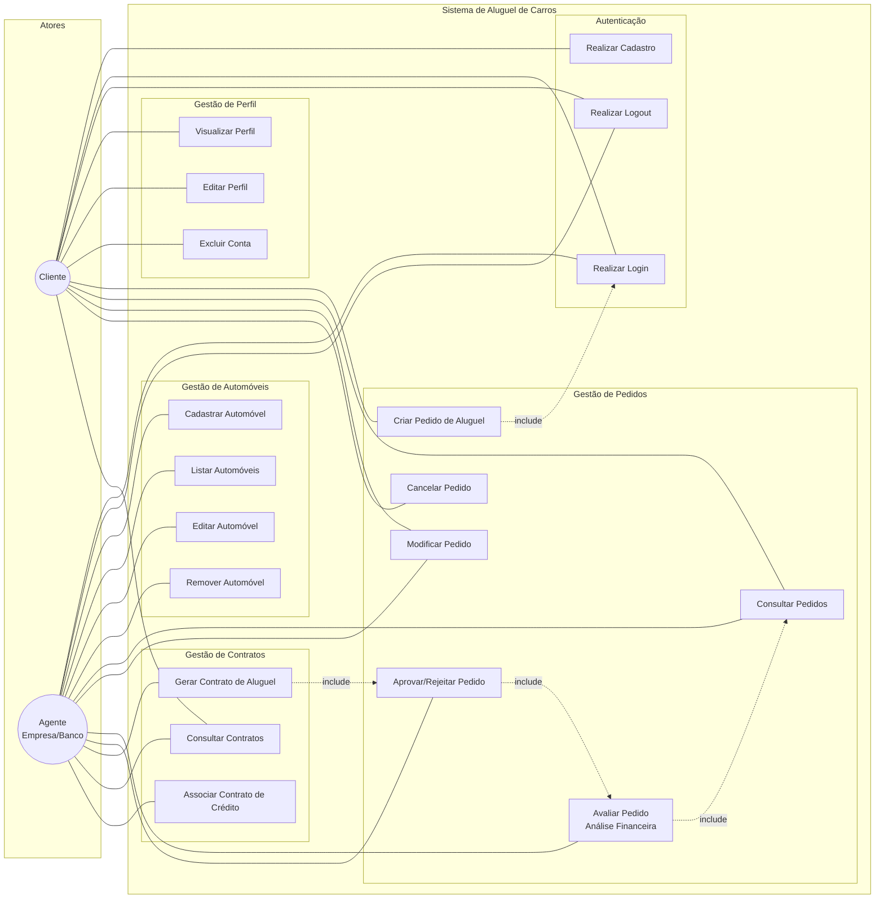

# Diagrama de Casos de Uso - Sistema de Aluguel de Carros

## Descrição dos Casos de Uso

| ID | Caso de Uso | Ator(es) | Descrição |
|----|------------|----------|-----------|
| UC01 | Realizar Cadastro | Cliente, Agente | Cadastro com email, senha e tipo de usuário |
| UC02 | Realizar Login | Cliente, Agente | Autenticação com email e senha (JWT) |
| UC03 | Realizar Logout | Cliente, Agente | Encerramento da sessão |
| UC04 | Visualizar Perfil | Cliente | Visualizar dados pessoais e empregadores |
| UC05 | Editar Perfil | Cliente | Alterar dados pessoais e empregadores |
| UC06 | Excluir Conta | Cliente | Remover conta e dados do sistema |
| UC07 | Cadastrar Automóvel | Agente | Registrar novo automóvel no sistema |
| UC08 | Listar Automóveis | Cliente, Agente | Visualizar automóveis disponíveis |
| UC09 | Editar Automóvel | Agente | Alterar dados de um automóvel |
| UC10 | Remover Automóvel | Agente | Remover automóvel do sistema |
| UC11 | Criar Pedido de Aluguel | Cliente | Solicitar aluguel de um automóvel |
| UC12 | Consultar Pedidos | Cliente, Agente | Visualizar pedidos e seus status |
| UC13 | Modificar Pedido | Cliente, Agente | Alterar dados de um pedido pendente |
| UC14 | Cancelar Pedido | Cliente | Cancelar um pedido pendente ou em análise |
| UC15 | Avaliar Pedido | Agente | Análise financeira do cliente |
| UC16 | Aprovar/Rejeitar Pedido | Agente | Decisão final sobre o pedido |
| UC17 | Gerar Contrato de Aluguel | Agente | Criação automática do contrato na aprovação |
| UC18 | Consultar Contratos | Cliente, Agente | Visualizar contratos ativos |
| UC19 | Associar Contrato de Crédito | Agente (Banco) | Vincular financiamento ao contrato |
