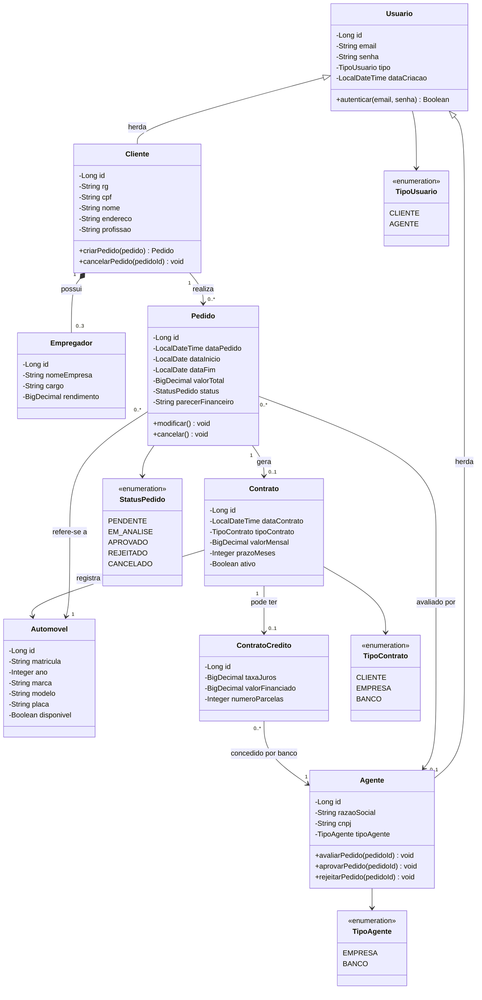

# Diagrama de Classes - Sistema de Aluguel de Carros

## Decisões de Projeto

| Decisão | Justificativa |
|---------|--------------|
| `Usuario` como classe base com herança para `Cliente` e `Agente` | Evita duplicação de atributos de autenticação (email, senha). Usa estratégia JOINED no JPA. |
| `Empregador` como composição (0..3) do `Cliente` | O PDF especifica máximo 3 entidades empregadoras com rendimentos. Composição porque empregador não existe sem cliente. |
| `ContratoCredito` como classe separada | Nem todo contrato tem crédito. Apenas agentes do tipo BANCO podem conceder. Relação opcional (0..1). |
| `TipoContrato` (CLIENTE/EMPRESA/BANCO) | O PDF diz que automóveis podem ser propriedade de clientes, empresas ou bancos dependendo do tipo de contrato. |
| `StatusPedido` como enum com 5 estados | Fluxo completo: PENDENTE → EM_ANALISE → APROVADO/REJEITADO, com possibilidade de CANCELADO pelo cliente. |
