# Diagrama de Pacotes - Visão Lógica - Sistema de Aluguel de Carros

```mermaid
flowchart TB
    subgraph frontend["Frontend (React + Vite)"]
        direction TB
        subgraph pages["pages"]
            LoginPage
            CadastroPage
            DashboardPage
            ClientesPage
            AutomoveisPage
            PedidosPage
            ContratosPage
        end
        subgraph components["components"]
            Header
            Sidebar
            Forms
            Tables
            Modals
        end
        subgraph feServices["services"]
            AuthServiceFE[AuthService]
            ApiService
        end
        subgraph contexts["contexts"]
            AuthContext
        end
        pages --> components
        pages --> feServices
        pages --> contexts
    end

    subgraph api["API REST (HTTP/JSON)"]
        REST[Endpoints REST]
    end

    subgraph backend["Backend (Spring Boot - MVC)"]
        direction TB
        subgraph controller["controller"]
            AuthController
            ClienteController
            AgenteController
            AutomovelController
            PedidoController
            ContratoController
        end
        subgraph service["service"]
            AuthServiceBE[AuthService]
            ClienteService
            AgenteService
            AutomovelService
            PedidoService
            ContratoService
        end
        subgraph model["model"]
            Usuario
            Cliente
            Agente
            Empregador
            Automovel
            Pedido
            Contrato
            ContratoCredito
        end
        subgraph repository["repository"]
            UsuarioRepository
            ClienteRepository
            AgenteRepository
            AutomovelRepository
            PedidoRepository
            ContratoRepository
        end
        subgraph config["config"]
            SecurityConfig
            CorsConfig
            JwtConfig
        end
        controller --> service
        service --> repository
        service --> model
        repository --> model
    end

    subgraph database["Supabase (PostgreSQL)"]
        direction LR
        tb_usuarios[(usuarios)]
        tb_clientes[(clientes)]
        tb_agentes[(agentes)]
        tb_empregadores[(empregadores)]
        tb_automoveis[(automoveis)]
        tb_pedidos[(pedidos)]
        tb_contratos[(contratos)]
        tb_credito[(contratos_credito)]
    end

    frontend -->|"Requisições HTTP"| api
    api -->|"Roteia para"| backend
    backend -->|"JDBC / JPA"| database
```

## Descrição das Camadas

| Camada | Tecnologia | Responsabilidade |
|--------|-----------|-----------------|
| **Frontend** | React + Vite | Interface do usuário, navegação, formulários, consumo da API REST |
| **API REST** | HTTP/JSON | Interface de comunicação entre frontend e backend |
| **Controller** | Spring MVC | Recebe requisições HTTP, valida entrada, delega para services |
| **Service** | Spring Boot | Lógica de negócio, regras de validação, orquestração |
| **Repository** | Spring Data JPA | Acesso ao banco de dados, queries |
| **Model** | JPA Entities | Mapeamento objeto-relacional das entidades |
| **Config** | Spring Security | Autenticação JWT, CORS, configurações |
| **Database** | Supabase (PostgreSQL) | Persistência dos dados |
