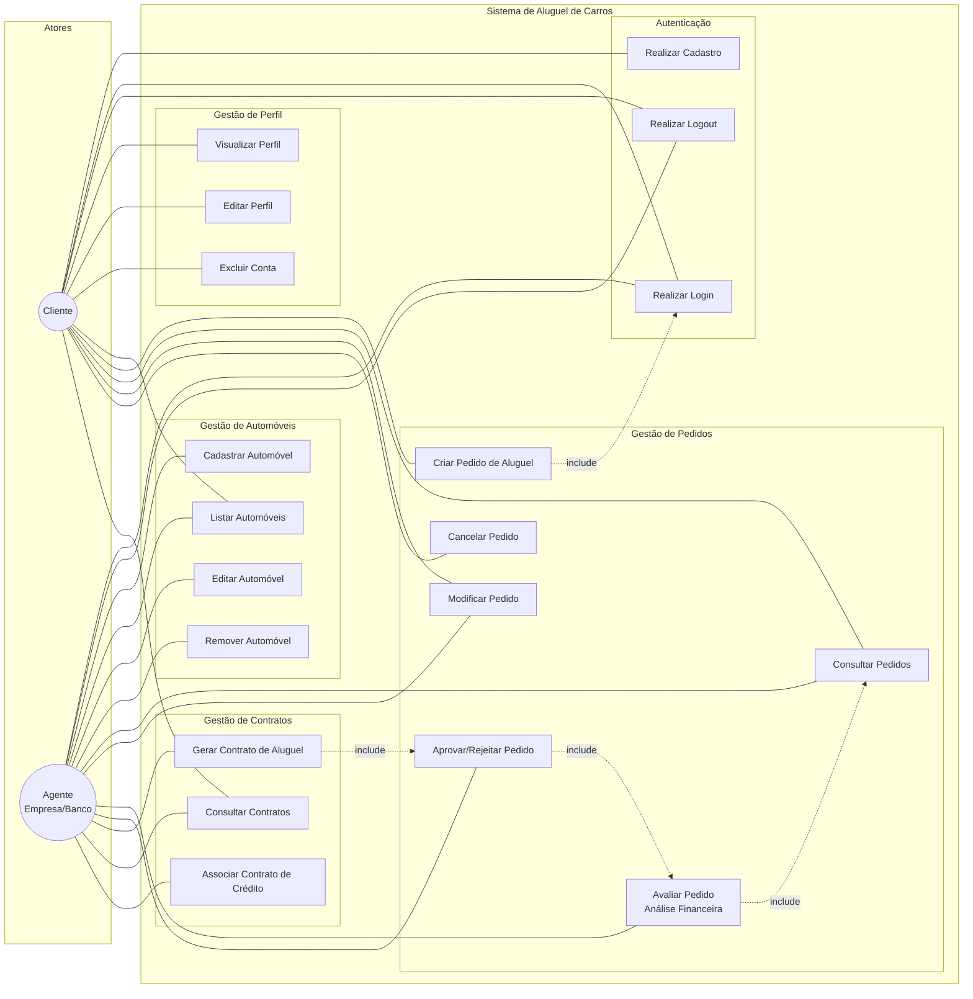

# Diagrama de Casos de Uso (v2 - Revisado) - Sistema de Aluguel de Carros

> **Revisão:** Sem alterações significativas em relação à v1. O diagrama de casos de uso se manteve estável durante o desenvolvimento, pois os requisitos funcionais foram bem definidos desde o início da modelagem.

## Alterações em relação à v1

| Alteração | Motivo |
|-----------|--------|
| Adicionado UC08 para ambos os atores | Na implementação, tanto Cliente quanto Agente podem listar automóveis (Cliente apenas visualiza, Agente também gerencia) |
| Nenhuma outra alteração | Os casos de uso se mantiveram conforme a especificação inicial |

