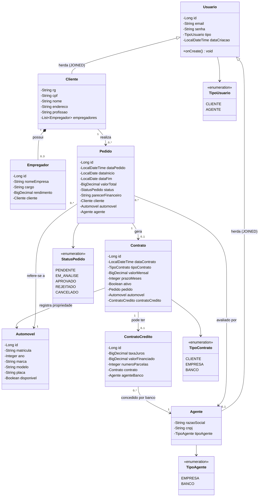

# Diagrama de Classes (v2 - Revisado) - Sistema de Aluguel de Carros

> **Revisão:** Este diagrama foi atualizado após a fase de implementação para refletir as decisões técnicas tomadas durante o desenvolvimento do sistema.

## Alterações em relação à v1

| Alteração | Motivo |
|-----------|--------|
| Adicionado `@PrePersist` em `Usuario.dataCriacao` | A data de criação é preenchida automaticamente pelo JPA ao persistir, não pelo usuário |
| Removido método `autenticar()` de `Usuario` | A autenticação é feita pelo `AuthService` com BCrypt + JWT, não pela entidade |
| Adicionados métodos de negócio nos Services | A lógica de negócio foi movida para a camada Service (MVC), não fica nas entidades |
| `Contrato.valorMensal` calculado automaticamente | Na aprovação, o valor mensal é calculado com base no `valorTotal` do pedido e `prazoMeses` |
| Adicionado `Pedido.automovelDescricao` e `clienteNome` como campos derivados | Usados nos DTOs para exibição no frontend sem precisar de joins extras |
| Estratégia de herança `JOINED` confirmada | Cada subclasse (Cliente, Agente) tem sua própria tabela no banco, referenciando `usuarios` |

