# Diagrama de Pacotes - Visão Lógica (v2 - Revisado) - Sistema de Aluguel de Carros

> **Revisão:** Este diagrama foi atualizado para refletir a estrutura final implementada no código, incluindo ajustes de pacotes e componentes que surgiram durante o desenvolvimento.

## Alterações em relação à v1

| Alteração | Motivo |
|-----------|--------|
| Adicionado pacote `model/enums` | Enums (`TipoUsuario`, `TipoAgente`, `StatusPedido`, `TipoContrato`) foram separados em subpacote para organização |
| Removido pacote `security` separado | Configurações de segurança (JWT, filtros) ficaram dentro do pacote `config`, pois são configurações do Spring |
| Frontend: adicionados componentes `PrivateRoute` e `Layout` | Necessários para proteger rotas e criar layout consistente com sidebar |
| Banco: confirmada a ausência do pacote `migration` | O Hibernate `ddl-auto=update` gerencia o schema automaticamente, sem Flyway/Liquibase |
| DTOs incluem campos derivados | `PedidoDTO` inclui `clienteNome` e `automovelDescricao` para evitar múltiplas chamadas à API no frontend |

```mermaid
flowchart TB
    subgraph frontend["Frontend (React + Vite)"]
        direction TB
        subgraph pages["pages"]
            LoginPage
            RegisterPage
            DashboardPage
            PerfilPage
            AutomoveisPage
            PedidosPage
            ContratosPage
        end
        subgraph components["components"]
            Header
            Sidebar
            Layout
            PrivateRoute
        end
        subgraph feServices["services"]
            api.js
            authService.js
            clienteService.js
            automovelService.js
            pedidoService.js
            contratoService.js
        end
        subgraph contexts["contexts"]
            AuthContext
        end
        pages --> components
        pages --> feServices
        pages --> contexts
    end

    subgraph apiLayer["API REST (HTTP/JSON)"]
        REST[Endpoints REST]
    end

    subgraph backend["Backend (Spring Boot - MVC)"]
        direction TB
        subgraph controller["controller"]
            AuthController
            ClienteController
            AgenteController
            AutomovelController
            PedidoController
            ContratoController
        end
        subgraph service["service"]
            AuthService
            ClienteService
            AgenteService
            AutomovelService
            PedidoService
            ContratoService
        end
        subgraph model["model"]
            Usuario
            Cliente
            Agente
            Empregador
            Automovel
            Pedido
            Contrato
            ContratoCredito
            subgraph enums["enums"]
                TipoUsuario
                TipoAgente
                StatusPedido
                TipoContrato
            end
        end
        subgraph repository["repository"]
            UsuarioRepository
            ClienteRepository
            AgenteRepository
            EmpregadorRepository
            AutomovelRepository
            PedidoRepository
            ContratoRepository
            ContratoCreditoRepository
        end
        subgraph dto["dto"]
            LoginRequest
            RegisterRequest
            AuthResponse
            ClienteDTO
            AgenteDTO
            AutomovelDTO
            PedidoDTO
            ContratoDTO
            ContratoCreditoDTO
        end
        subgraph config["config"]
            SecurityConfig
            JwtService
            JwtAuthenticationFilter
        end
        controller --> service
        controller --> dto
        service --> repository
        service --> model
        service --> dto
        repository --> model
    end

    subgraph database["Supabase (PostgreSQL)"]
        direction LR
        tb_usuarios[(usuarios)]
        tb_clientes[(clientes)]
        tb_agentes[(agentes)]
        tb_empregadores[(empregadores)]
        tb_automoveis[(automoveis)]
        tb_pedidos[(pedidos)]
        tb_contratos[(contratos)]
        tb_credito[(contratos_credito)]
    end

    frontend -->|"Requisições HTTP"| apiLayer
    apiLayer -->|"Roteia para"| backend
    backend -->|"JDBC / JPA"| database
```

